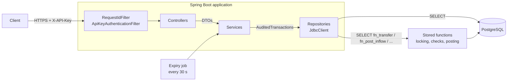

# Merchant Wallet

A merchant wallet system built for high level assessment. Businesses register, get a NUBAN account, and move money between accounts on a double-entry ledger. On top of the two required features it supports subsidiary accounts with auto-sweep and one-time, time-limited dynamic accounts.

**Stack:** Java 21 · Spring Boot 3.4 · PostgreSQL 17 · Flyway · plain JDBC (`JdbcClient`, no JPA) · PL/pgSQL stored functions · Testcontainers · Docker Compose · OpenAPI / Swagger UI

---

## Contents

1. [What it does](#what-it-does)
2. [Quick start](#quick-start)
3. [Try it](#try-it)
4. [Architecture](#architecture)
5. [The ledger](#the-ledger)
6. [Design decisions](#design-decisions)
7. [API reference](#api-reference)
8. [Testing](#testing)
9. [Configuration](#configuration)
10. [Assumptions](#assumptions)

---

## What it does

| Requirement | How it is met |
|---|---|
| **1. Create a user & generate account** | `POST /api/v1/merchants` registers a business and, in the same database transaction, opens its **primary account** with a unique, CBN-check-digit-valid **NUBAN**. Returns an API key (shown once). |
| **2. Fund transfer between accounts** | `POST /api/v1/transfers` moves money from one of the caller's accounts to any account in the system, with **idempotency**, **row-level locking**, **no overdrafts**, and a **double-entry** record of every movement. |

Extensions built on the same ledger:

| Feature | Summary |
|---|---|
| **Subsidiary accounts** | Persistent accounts under a merchant (e.g. a branch), each with its own NUBAN and holder details. Either **hold their own balance** or **auto-sweep** every credit straight to the primary account. |
| **Dynamic accounts** | One-time NUBANs a merchant gives a customer to pay into within **10 minutes**. Paid in time → credited to the primary account. Late or repeat payments → held in a **suspense** account. Numbers are recycled safely after a cooldown. |
| **Simulated inflows** | `POST /api/v1/simulate/inflows` stands in for an incoming NIP transfer so accounts can be funded in a sandbox. Deduplicated by session id. |
| **Statements** | Transaction history per account with running balance and counterparty, keyset-paginated. |
| **Audit trail** | Every change to merchants, accounts and dynamic accounts is recorded with who did it and in which request. Money tables are immutable at the database level. |

---

## Quick start

**Prerequisites:** Docker. (Java 21 only if you want to run outside Docker.)

### Run everything in Docker

```bash
docker compose --profile full up --build
```

- API: http://localhost:8080
- Swagger UI: **http://localhost:8080/swagger-ui.html**
- Health: http://localhost:8080/actuator/health
- Postgres: `localhost:5433` (user `wallet`, password `wallet`, database `merchant_wallet`)

Flyway creates the schema and stored functions on startup. Stop with `Ctrl+C`; `docker compose down -v` also removes the data.

### Run the app locally (for development)

```bash
docker compose up -d          # Postgres only
./mvnw spring-boot:run        # the app, on port 8080
```

### Run the tests

```bash
./mvnw clean test
```

Docker must be running: integration tests start their own throwaway Postgres with Testcontainers and apply the real migrations.

> Postgres is exposed on **5433**, not 5432, so it does not clash with a Postgres you may already run locally.

---

## Try it

The easiest way is **Swagger UI** at http://localhost:8080/swagger-ui.html:

1. **Merchants → POST /api/v1/merchants** → *Try it out* → *Execute*. Copy `apiKey` from the response.
2. Click **Authorize**, paste the key.
3. **Simulation → POST /api/v1/simulate/inflows** to fund the primary account.
4. **Transfers → POST /api/v1/transfers** to move money (send a unique `Idempotency-Key`).
5. **Accounts → GET …/statement** to see the history.

Or with curl:

```bash
# 1. Register (copy apiKey and primaryAccount.accountNumber from the response)
curl -s -X POST http://localhost:8080/api/v1/merchants -H "Content-Type: application/json" \
  -d '{"businessName":"Northstar Logistics","businessType":"SOLE_PROPRIETORSHIP","email":"ops@northstar.example","phone":"08062349175"}'

# 2. Fund it with NGN 50,000
curl -s -X POST http://localhost:8080/api/v1/simulate/inflows -H "X-API-Key: <apiKey>" -H "Content-Type: application/json" \
  -d '{"accountNumber":"<accountNumber>","amount":50000,"senderName":"Chidi Eze","sessionId":"NIP-0001"}'

# 3. Transfer NGN 2,500 to another merchant's account
curl -si -X POST http://localhost:8080/api/v1/transfers -H "X-API-Key: <apiKey>" \
  -H "Idempotency-Key: demo-0001" -H "Content-Type: application/json" \
  -d '{"sourceAccountNumber":"<accountNumber>","destinationAccountNumber":"<otherAccount>","amount":2500,"narration":"Delivery fees"}'

# 4. Statement
curl -s http://localhost:8080/api/v1/accounts/<accountNumber>/statement -H "X-API-Key: <apiKey>"
```

Run step 3 twice: the second call returns the same transaction with header `Idempotent-Replayed: true` and nothing is debited again.

---

## Architecture

A **modular monolith**: one deployable, organised by feature so each module could become a service later.



| Layer | Responsibility |
|---|---|
| **Filters** | Correlation id on every request; API-key authentication for `/api/**`. |
| **Controllers** | HTTP only: validate request DTOs, call a service, map the result to a response DTO. |
| **Services** (interface + `Impl`) | Use cases: normalise input, open the audited transaction, map outcomes to errors. Free of HTTP, so reusable from jobs or other entry points. |
| **Repositories** (interface + `Jdbc…`) | Explicit SQL with `JdbcClient` and one `RowMapper` per table. |
| **Stored functions** | Everything that moves money or allocates a scarce resource: locking, balance checks, ledger posting, auto-sweep, dynamic account routing. |

Domain models (`Merchant`, `Account`, `Transaction`, …) are immutable classes that never leave the service layer; the API only ever returns DTO records.

```
src/main/java/com/threeline/merchantwallet
├── common          # errors, money, request context, audited transactions, security, OpenAPI, scheduling
├── merchant        # registration and profile
├── account         # primary/subsidiary accounts, NUBAN generation, statements
├── ledger          # transactions, ledger entries, transfers, inflows
├── dynamicaccount  # one-time accounts, expiry job
└── simulation      # sandbox inflow endpoint
src/main/resources/db/migration
├── V1…V6           # schema, seed GL accounts, ledger type, dynamic accounts, immutability & audit
└── R__fn_*.sql     # stored functions (re-applied by Flyway whenever they change)
```

---

## The ledger

### Two layers: what was attempted, and what moved

| Table | Role | Mutability |
|---|---|---|
| `transactions` | **The process table.** One row per money operation *attempted*: `TRANSFER`, `INFLOW`, `SWEEP`. Includes failed attempts with a `failure_code`. | Status may move once: `PENDING → SUCCESSFUL \| FAILED`. Then frozen. |
| `ledger_entries` | **The accounting.** Written only for successful transactions: at least one debit and one credit that sum to zero, each with `balance_after`. | Append-only. |
| `accounts` | Every balance holder, including two platform GL accounts. `balance` is a cache of the entries, updated in the same DB transaction. | Identity fields frozen; balance only via the ledger. |

### Double entry from the platform's point of view

| Account | Kind | Normal side | A credit… |
|---|---|---|---|
| Merchant primary / subsidiary | Liability (money we owe the merchant) | `CREDIT` | increases it |
| `SYS_SUSPENSE` | Liability (money held until resolved) | `CREDIT` | increases it |
| `SYS_INBOUND_SETTLEMENT` | Asset (cash received from the rails) | `DEBIT` | decreases it |

### Every flow as journal entries

| Flow | Debit | Credit |
|---|---|---|
| Inflow to an account | `SYS_INBOUND_SETTLEMENT` | Receiving account |
| Transfer | Source account | Destination account |
| Auto-sweep (after a credit to an auto-sweep subsidiary) | Subsidiary | Merchant's primary |
| Payment to a dynamic account, in time | `SYS_INBOUND_SETTLEMENT` | Merchant's primary |
| Payment to a dynamic account, late or repeated | `SYS_INBOUND_SETTLEMENT` | `SYS_SUSPENSE` |

### Invariants (checked by the tests after every concurrency scenario)

1. Each transaction's debits equal its credits.
2. Each account's cached `balance` equals the sum of its ledger entries.
3. **Assets = liabilities**: total debit-normal balances equal total credit-normal balances.

All writes go through **one** function, `fn_post_journal`. It rejects unbalanced journals, locks accounts in a fixed order, applies each line, records `balance_after`, and marks the transaction `SUCCESSFUL`. Nothing else may touch a balance: the database rejects any other `UPDATE` of `accounts.balance`.

---

## Design decisions

### Money logic in PostgreSQL stored functions
Transfers, inflows, sweeps and dynamic-account routing run in PL/pgSQL (`fn_transfer`, `fn_post_inflow`, …). Locking, the balance check and the posting happen in one round trip inside one transaction, so there is no window between "check balance" and "debit". The rules hold no matter who calls the database. Java orchestrates: it validates input, opens an audited transaction, calls the function, and maps the result. Simple reads stay as plain `SELECT`s in Java.

*Trade-off:* logic is split across two languages and functions are harder to unit test. Every function is therefore covered by integration tests against real Postgres.

### No JPA
For a ledger, every lock, statement and transaction boundary should be explicit. `JdbcClient` with hand-written SQL and named constraints keeps them visible; no lazy loading or dirty checking decides when writes happen. Transactions are opened explicitly through `AuditedTransactions` rather than `@Transactional`, which is silently skipped on self-invocation.

### Money as `BIGINT` kobo
No floating point anywhere. Amounts are converted from naira at the API edge; more than two decimal places is rejected, never rounded.

### Concurrency
- **No double-spend:** the source and destination rows are locked (`SELECT … FOR UPDATE`) *before* the balance is read.
- **No deadlocks:** all functions lock accounts through `fn_lock_accounts`, always in ascending id order. That includes the merchant's primary when the destination is an auto-sweep subsidiary, so the sweep never takes a lock late.
- **Backstop:** `CHECK (balance >= 0)` on customer accounts rejects an overdraft even if application logic were wrong.

### Idempotency
- Transfers require an `Idempotency-Key` header. The key is stored with a SHA-256 fingerprint of the request.
- Same key and same body → the original result is returned (`Idempotent-Replayed: true`). Same key, different body → `409 IDEMPOTENCY_KEY_REUSED`.
- Concurrent retries with one key are serialised by a transaction-scoped **advisory lock**, so exactly one posts.
- Inflows are deduplicated by the rail's session id, the way repeated NIP notifications would be.

### Rejected requests vs failed transactions
| Kind | Examples | Recorded? | HTTP |
|---|---|---|---|
| **Rejected request** | Unknown account, someone else's account, same source and destination, reused key | No | 400 / 404 / 409 / 422 |
| **Failed transaction** | Insufficient funds, frozen account | Yes, `FAILED` with reason and reference | 422 with `transactionReference` |

Every legitimate attempt leaves a trace; malformed requests do not pollute the ledger.

### NUBAN generation: unique by construction
1. A 9-digit serial comes from a Postgres **sequence** (`NO CYCLE`), which never returns a value twice.
2. The serial is passed through an **affine permutation** `(a·x + b) mod 10⁹` with `gcd(a, 10) = 1`. That is a bijection, so outputs stay unique but are no longer sequential or guessable. Tests prove it with an inverse function.
3. The **CBN check digit** is appended (weights `3,7,3,3,7,3,3,7,3,3,7,3` over bank code + serial). Any single-digit typo is always detected; the tests try every one.

The `UNIQUE` constraint is a backstop, not the mechanism. Primary, subsidiary and dynamic numbers share the sequence, so they can never collide.

### Dynamic accounts
- **The number and the lease are separate.** A number is a recycled routing address; the lease (`DYN-…`) is permanent and is what every payment links to.
- **A dynamic number never holds a balance.** Payments in time go straight to the merchant's primary account.
- **Expiry time is the source of truth.** A payment one second late is late even if the expiry job has not run yet; the API also computes status from the clock. The job is only housekeeping and is safe to run on several instances (`SKIP LOCKED`).
- **Late or repeat payments go to suspense**, linked to the original lease, never credited to whoever holds the number now.
- **24-hour cooldown before reuse**, so late payments and bank retries always hit the old lease.
- **Allocation uses `FOR UPDATE SKIP LOCKED`**, so concurrent requests never get the same number; the pool grows on demand.

### Immutability and audit (enforced in the database)
- `ledger_entries` and `audit_log` are append-only.
- Completed transactions and finished dynamic accounts are frozen; identity fields (account number, owner, type, currency) can never change.
- Merchants, accounts, transactions and dynamic accounts cannot be deleted; they change status instead.
- A balance can only change inside `fn_post_journal`.
- Every allowed change to merchants, accounts and dynamic accounts is written to `audit_log` with old and new values, the **actor** (`merchant:<publicId>` or `system:<job>`) and the **request id**, passed to Postgres with `set_config` at the start of each transaction.

### Authentication
One scheme: a per-merchant API key in `X-API-Key`. Keys are 256 bits from `SecureRandom`; only their SHA-256 hash is stored. Hashing is deterministic, so lookup is a single indexed query, and a slow password hash adds nothing for a random 256-bit secret. A small filter is used instead of Spring Security because there are no sessions, roles or OAuth flows to manage.

### Errors
Every error is RFC 7807 `application/problem+json` with a stable `code`, the `requestId` and a timestamp. Database constraint violations that represent business outcomes (e.g. a duplicate email lost in a race) are translated by constraint name. Anything unexpected becomes a generic 500 and is logged in full; internal details are never returned.

Another merchant's account returns **404, not 403**, so the API does not confirm that an account exists.

---

## API reference

Full, interactive documentation: **http://localhost:8080/swagger-ui.html** (OpenAPI JSON at `/v3/api-docs`, importable into Postman).

| Method | Path | Auth | Description |
|---|---|---|---|
| `POST` | `/api/v1/merchants` | Public | Register a merchant and open its primary account (**requirement 1**) |
| `GET` | `/api/v1/merchants/me` | Key | Caller's profile |
| `GET` | `/api/v1/accounts` | Key | Caller's accounts, primary first |
| `GET` | `/api/v1/accounts/{accountNumber}` | Key | One account with balance |
| `GET` | `/api/v1/accounts/{accountNumber}/statement` | Key | History: `?limit=20&before=<nextCursor>` |
| `POST` | `/api/v1/accounts/subsidiaries` | Key | Open a subsidiary (`autoSweep` true/false) |
| `PATCH` | `/api/v1/accounts/{accountNumber}/auto-sweep` | Key | Turn auto-sweep on or off |
| `POST` | `/api/v1/transfers` | Key + `Idempotency-Key` | Transfer funds (**requirement 2**) |
| `GET` | `/api/v1/transactions/{reference}` | Key | Any of the caller's transactions |
| `POST` | `/api/v1/dynamic-accounts` | Key | Issue a one-time account (optional `accountName`, `expectedAmount`) |
| `GET` | `/api/v1/dynamic-accounts/{reference}` | Key | Status: `ACTIVE` / `PAID` / `EXPIRED` |
| `GET` | `/api/v1/dynamic-accounts` | Key | Recent dynamic accounts |
| `POST` | `/api/v1/simulate/inflows` | Key | Simulate an incoming bank transfer |

### Error codes clients can branch on

| HTTP | `code` |
|---|---|
| 400 | `VALIDATION_FAILED`, `MALFORMED_REQUEST`, `INVALID_AMOUNT` |
| 401 / 403 | `UNAUTHORIZED`, `MERCHANT_NOT_ACTIVE` |
| 404 | `ACCOUNT_NOT_FOUND`, `TRANSACTION_NOT_FOUND`, `DYNAMIC_ACCOUNT_NOT_FOUND`, `MERCHANT_NOT_FOUND` |
| 409 | `MERCHANT_ALREADY_EXISTS`, `IDEMPOTENCY_KEY_REUSED`, `DUPLICATE_REQUEST` |
| 422 | `INSUFFICIENT_FUNDS`, `ACCOUNT_NOT_ACTIVE`, `SAME_ACCOUNT_TRANSFER`, `CURRENCY_MISMATCH`, `NOT_A_SUBSIDIARY`, `DYNAMIC_ACCOUNT_AMOUNT_MISMATCH` |

---

## Testing

`./mvnw clean test` runs unit tests plus integration tests against a real PostgreSQL (Testcontainers) with the real migrations. One container is shared by the whole run; tables are truncated before each test.

| Area | What is proven |
|---|---|
| **Concurrency** (`TransferConcurrencyTest`) | 50 parallel NGN 500 transfers against NGN 10,000: exactly 20 succeed, 30 fail, balance ends at 0. 80 simultaneous A→B / B→A transfers: no deadlock. 10 concurrent retries with one key: one transaction. Ledger invariants hold after each. |
| **Transfers** (`TransferApiTest`) | Success with statement; insufficient funds recorded as `FAILED`; replay; key reuse; spending another merchant's money; rejections leave no rows; auto-sweep and holding subsidiaries; duplicate inflow session. |
| **Dynamic accounts** | Valid NUBAN live for 10 min; in-time payment to primary; one-time use; expected amount; 25 concurrent issues get 25 different numbers; late payment to suspense before the job runs; safe recycling to another merchant. |
| **NUBAN** | Hand-computed check digits; every single-digit error detected; scrambler is a bijection (100,000 round trips); 50,000 generated numbers unique. |
| **Database guarantees** | Balance cannot change outside the ledger; account number cannot change; audit rows carry actor and request id. |
| **API** | Registration, validation, auth, ownership (404 for other merchants' resources), subsidiaries, OpenAPI document. |

---

## Configuration

`src/main/resources/application.yml`:

| Property | Default | Meaning |
|---|---|---|
| `wallet.nuban.bank-code` | `"999"` | Institution code used in the NUBAN check digit (mock) |
| `wallet.dynamic-accounts.ttl` | `PT10M` | How long a dynamic account accepts payment |
| `wallet.dynamic-accounts.cooldown` | `PT24H` | Wait before a used number can be leased again |
| `wallet.dynamic-accounts.expiry-job-enabled` | `true` | Run the housekeeping job |
| `wallet.dynamic-accounts.expiry-interval` | `PT30S` | Job interval |
| `wallet.simulation.enabled` | `true` | Expose `/api/v1/simulate/inflows` (disable in production) |

Docker overrides the datasource with `SPRING_DATASOURCE_URL`, `SPRING_DATASOURCE_USERNAME` and `SPRING_DATASOURCE_PASSWORD`.

---

## Assumptions

- **"User" is a merchant (business).** Registration captures business details; the generated account is the merchant's primary account. Business types: sole proprietorship, partnership, limited liability (RC number required), NGO.
- **Single currency (NGN)**, amounts in naira with at most two decimal places, stored as kobo.
- **Transfers are internal (book transfers)** between accounts on this platform. The source must belong to the caller; the destination can be any active account, including another merchant's.
- **No real payment rail.** Money enters through the simulation endpoint, which behaves like an inbound NIP credit (session-id deduplication, settlement GL). There are no outbound transfers to other banks.
- **The bank code `999` is a mock**; NUBANs are valid against it but not routable in the real NIP network.
- **API keys are static per merchant** and shown once. Rotation and multiple keys are out of scope.
- **Dynamic account rules:** one payment per account; `expectedAmount` is optional and, when set, other amounts are rejected (a real rail would reverse them); late and repeat payments are held in suspense.
- **Turning auto-sweep on** applies to future credits only; existing balance stays in the subsidiary.
- **Notifications are by polling** (`GET /dynamic-accounts/{reference}`, `GET /transactions/{reference}`) rather than webhooks.
